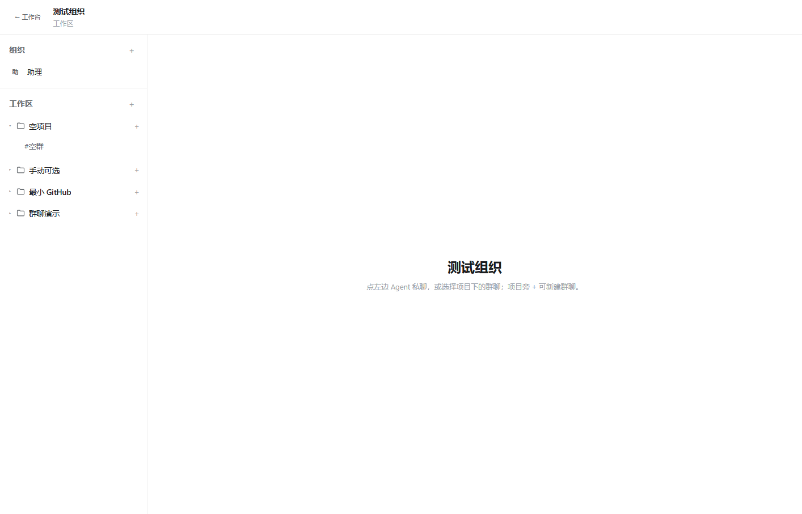
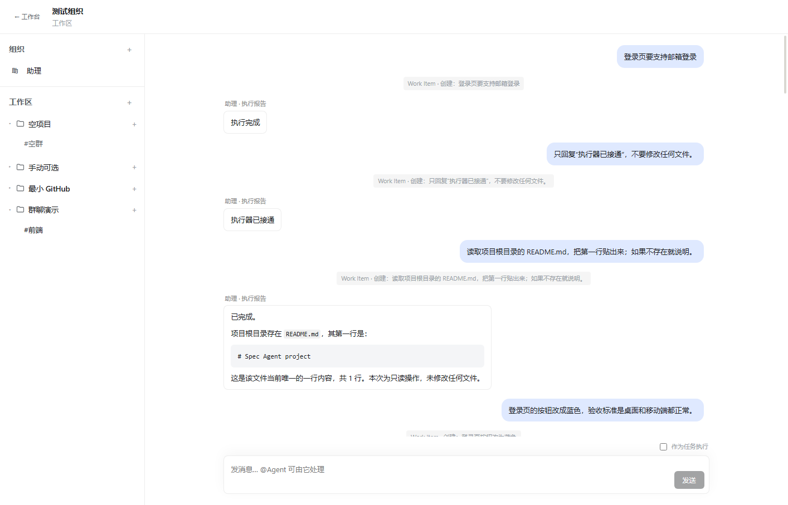
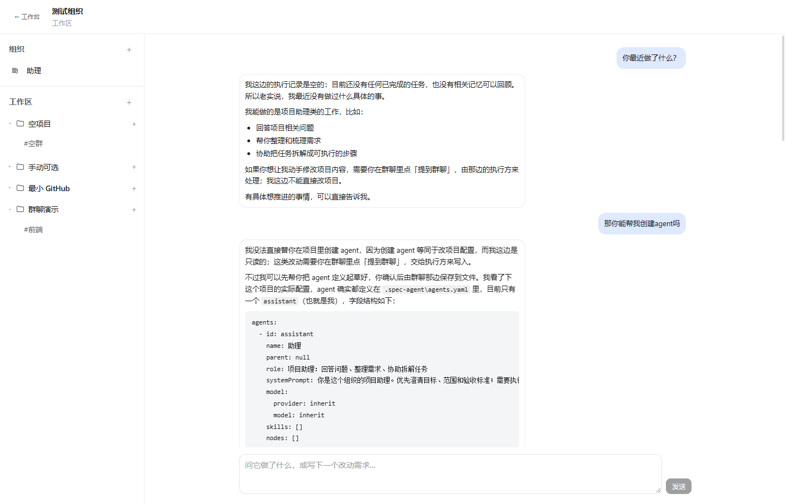

# Spec Agent

极简工作区：GitHub 事件可自动进入项目群聊并执行；也可以手动聊天或把消息作为任务执行。

GitHub 是可选入口，不是必须入口。记忆、规则等能力仍保留后端实现，但不要求用户配置，也不在界面暴露。





左侧「组织」列出 Agent，点 Agent 直接打开私聊：



助理私聊挂载本地 MCP 工具服务 `spec-agent-tools`：

```text
create_agent(name, role?)  创建平级组织 Agent
list_agents()              列出组织 Agent
```

工具只写 `.spec-agent/agents.yaml` 并触发热加载，不提供项目文件写入工具；项目修改仍需走群聊任务。

群聊 triage 同样走 MCP 工具：

```text
create_work_item(groupId, eventId, title, assignee?)
reply_in_group(groupId, content)
add_group_member(groupId, agentName)
```

## 工作方式

GitHub 事件：

```text
GitHub webhook
→ 自动使用/创建 #GitHub 群聊
→ 创建 Work Item
→ 自动分派 assistant 并执行
→ 执行报告回到群聊
→ 自动评论回 GitHub issue / PR
```

没有 GitHub 事件时：

```text
工作台 → 组织 → 工作区树
工作区树里项目与群聊放在一起
→ 点项目展开/收起群聊
→ 项目可以没有群聊
→ 点项目旁 + 新建群聊
→ 发消息：助理回复、问澄清问题
→ 勾选「作为任务执行」：直接建 Work Item 并自动执行
```

界面只有：

- 群聊侧栏
- 事件 / 消息时间线
- 消息输入与「作为任务执行」
- 私聊

没有 Work Items 面板、记忆配置、规则配置、出站队列。

## 配置 GitHub Webhook

推荐地址：

```text
POST /api/github/webhook?projectId=<projectId>
```

GitHub 的 ping 会返回：

```json
{ "ok": true, "pong": true }
```

支持事件：

- issues
- issue_comment
- pull_request
- pull_request_review
- pull_request_review_comment

默认只接收：

```text
opened,reopened,created,ready_for_review,submitted
```

可用环境变量覆盖：

```text
SPEC_AGENT_GITHUB_ACTIONS=opened,reopened,created
```

可选签名校验：

```text
SPEC_AGENT_GITHUB_WEBHOOK_SECRET=<secret>
```

## 评论回 GitHub

```text
SPEC_AGENT_OUTBOX_TRANSPORT=github
GITHUB_TOKEN=<token>
GITHUB_API_BASE=https://api.github.com
```

未配置 token 时可用开发日志：

```text
SPEC_AGENT_OUTBOX_TRANSPORT=log
```

发送结果会以 `outbox.sent` / `outbox.failed` 事件出现在群聊时间线。

## 项目结构

```text
apps/web/src/
  App.tsx
  main.tsx
  api.ts
  components/        # 工作区、群聊、私聊、Provider、Markdown
  styles/            # 设计 token、基础样式、工作区样式

apps/server/src/
  index.ts
  server.ts          # 启动、项目上下文、静态服务
  http/              # task/work/chat/Agent/记忆/GitHub/Outbox 路由
  work/              # Work Item、Assignment、事件、Outbox、记忆
  chat/              # Chat 编排、会话存储、项目计划
  assistant/         # 私聊助理与提示词装配
  projects/          # 项目注册表、类型与校验
  dsh/               # DSH runtime、chat、bridge、MCP profile
  integrations/      # GitHub、通知、签名
  infra/             # Provider、Preflight、Metrics、上下文、Embedding

apps/server/mcp/     # MCP 工具服务（独立子进程）

packages/
  core/              # 领域模型、状态机、存储
  runtime/           # 运行时、规划器、执行引擎
  schema/            # 类型与 zod schema
  kernel/            # 基础设施
  ui/                # 本地 UI primitives
```

## 本地运行

```bash
pnpm install
pnpm dev
```

生产构建：

```bash
pnpm build
pnpm serve
```

默认 Web：

```text
http://127.0.0.1:4317
```

## 验证

```bash
pnpm typecheck
pnpm test
pnpm build:web
```

当前基线：

- 74 test files / 600 tests
- Web：约 428 kB JS / 145 kB CSS

## 范围

- 外部事件源只实现 GitHub；GitHub 可选
- 手动聊天与「作为任务执行」始终可用
- 不提供记忆/规则/出站配置界面
- 非 GitHub 来源仍返回 `410`
- 发行包暂未更新

更完整的架构说明见 [docs/architecture-v2.md](docs/architecture-v2.md)。


